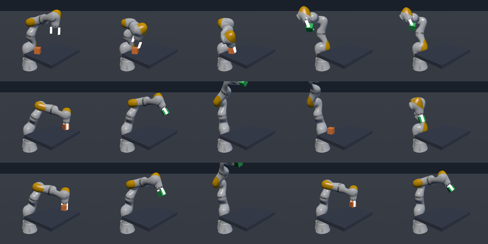

# KUKA friction grasp: a reset pool and success-guided sampling

The KUKA LBR iiwa 14 R820 (the arm from `examples/projects/RobotCell`) with a generated
two-finger parallel gripper learns with PPO to reach a cube on a table, close on it and lift it,
held by finger friction alone: no weld, no kinematic attach, no grasp-lock assist anywhere.

The June 2026 version (branch `kuka_grasp_rl`) never worked. It bootstrapped with a shaped
reward and a reset-height curriculum. This version keeps that env as the baseline (`--sampler
scaffold`) and adds the manipulation recipe of Zhang et al., "A Balanced Data Diet" (CoRL 2026,
arXiv 2610.12465): episodes start from a collision-checked pool of start configurations in
three families, one sparse reward is shared by all of them, and the start cell is drawn by
success-guided sampling (`threepp/rl/sgs.py`).

## Result, 2026-10-19

**Friction-only lifting from a Reaching start was achieved, but not reliably.** Four of the
six reset-pool runs learned it; the other two learned to hold cubes they start with and never
learned to reach. The June scaffold never lifted. The best policy (SGS arm, seed 0, iteration
1475; `runs/sgs_s0/ckpt/it01475.pt`, used below as `kuka_grasp.pt`, not tracked), lifts the cube 0.12 m by finger friction and holds it 0.5 s from 255
of the 256 held-out Reaching starts (127/128 with the arm near DEFAULT_Q, 128/128 with the
gripper IK-aligned above the cube), median 0.86 s after the start, no velocity violations.



Rows: a held-out Reaching start, a Stable Grasp start, a Near-Goal start; columns 0.02, 0.24,
0.46, 0.68 and 0.90 s. The cube is green while it counts toward success. In the Reaching row
the open fingers come down over the cube by 0.24 s, close by 0.46 s and carry it up and back
over the base. `play_kuka_grasp.py --video kuka_grasp.mp4` renders 15 s of the same three arms
in real time (1920x1080, 50 fps; 17 of 17, 22 of 22 and 23 of 23 episodes lifted).

All runs: K=512, PPO (512-256-128, lr 3e-4, horizon 32, 4 minibatches, target KL 0.02,
log_std -0.5 at the start), the same evaluation (256 held-out Reaching cells, mean action).
Seed 0 ran 1500 iterations (24.6M steps) per arm; seeds 1 and 2, 600 (9.8M), pool arms only.

| sampler | seed | iterations | Reaching success | near home | aligned | first iteration at 0.9 | what it learned |
|---|---|---|---|---|---|---|---|
| scaffold | 0 | 1500 | 0.000 | 0.000 | 0.000 | - | hovers centred above the cube, never closes |
| uniform | 0 | 1500 | 0.996 | 0.992 | 1.000 | 250 | the task |
| sgs | 0 | 1500 | 0.996 | 0.992 | 1.000 | 325 | the task |
| uniform | 1 | 600 | 0.699 | 0.445 | 0.953 | - | the task, still rising at the end |
| sgs | 1 | 600 | 0.000 | 0.000 | 0.000 | - | held starts only |
| uniform | 2 | 600 | 0.000 | 0.000 | 0.000 | - | held starts only (best 0.008, iteration 300) |
| sgs | 2 | 600 | 0.980 | 0.977 | 0.984 | 450 | the task |

Seed 0, evaluated success over training (all starts / near-home starts):

| iteration | 50 | 100 | 150 | 200 | 250 | 300 | 400 | 500 |
|---|---|---|---|---|---|---|---|---|
| uniform | 0.33 / 0.00 | 0.50 / 0.02 | 0.54 / 0.11 | 0.73 / 0.49 | 0.92 / 0.84 | 0.94 / 0.91 | 0.98 / 0.96 | 0.98 / 0.97 |
| sgs | 0.48 / 0.01 | 0.51 / 0.02 | 0.52 / 0.06 | 0.59 / 0.19 | 0.68 / 0.38 | 0.89 / 0.77 | 0.99 / 0.98 | 1.00 / 1.00 |

What the runs show:

- **The two failed runs never bridge from held starts to reaching.** Both solve the Stable Grasp
  and Near-Goal starts within 50 iterations (training success 1.00 from then on) while their
  success on Reaching draws stays 0.00 for all 600 iterations; the mean grasp-point-to-cube
  distance over all training steps stays near 0.4 m (0.06 in sgs seed 2) and the exploration
  noise shrinks (log_std -0.50 to -0.89). In the runs that work, a few IK-aligned Reaching
  starts (gripper 4-15 cm above the cube) succeed by chance early on and reaching grows from
  there; at iteration 50 their training success on Reaching was 0.005 to 0.19, against 0.000
  in the two that failed, so the margin at that point is thin. The pool has no
  start between "cube already gripped" and "gripper open, 4 cm or more above the cube". The
  paper's Near-Goal family places the gripper around the object by IK with randomised
  aperture, which is that missing start: open fingers straddling the cube, needing only a close
  and a lift. This pool follows the brief's Near-Goal (the cube already held); adding the open
  pre-grasp start is the change the failures point to. It has not been tried.
- **Success-guided sampling made no measurable difference here.** Seed 0: uniform reached 0.9 at
  iteration 250, SGS at 325, both ended at 0.996. Seeds 1 and 2: each sampler has one run that
  learned the task and one that did not. Two effects visible in the logs: the kernel gives a
  never-solved cell about 7x less draw weight than one at 0.5 (target 0.5, kappa 1,
  temperature 2), and the near-home Reaching cells, half the evaluation, sit at 0 the longest;
  at iteration 200 SGS's training success on the Reaching cells it drew was 0.84 while its
  evaluated success from near-home starts was 0.19 (uniform: 0.49). And when every cell is at
  0 or 1, as in the two failed runs, every cell gets the floor weight and SGS draws as
  uniformly as the uniform arm, so it cannot pull a run out of that state. 512 envs and 4096
  cells is far from the paper's regime.
- **The scaffold converges to hovering.** After 1500 iterations its per-step reward means are
  reach +0.52, down +0.98, centre +0.40, descend +0.41 and close, grasp, lift 0.000: it holds
  the tool down, centred over the cube, and never closes. It differs from the pool arms in reward,
  resets and the action mapping (absolute, June) at once; a scaffold run with delta actions
  was not made, so how much of its failure the action mapping explains is not measured. Under
  the absolute mapping a fresh policy also lost every held start (none of the ~3,100 episodes
  of a 30-iteration pool run succeeded, held starts included), which the delta mapping fixed
  (0.998 success on held starts at iteration 40).
- **Evaluation noise:** the same policy evaluated in two processes scored 1.000 and 0.996: one
  cell of 256 flips between runs (GPU PhysX is not bit-reproducible across scenes).
- **Cost on the laptop (RTX 4060, 25 W cap):** seed 0, three trainers and the evaluator sharing
  the GPU (90 % busy, 23 W): 5.2k steps/s per run, 78 min per 1500-iteration run; seeds 1 and
  2, four trainers at once: 6.6k steps/s per run, ~25 min per 600 iterations. One run alone:
  7.2k steps/s. An evaluation takes 2-8 s. The pool env builds in 0.6-2.3 s, the scaffold in
  7.4 s (its IK posture is settled in PhysX). One seed-2 run died in cuBLAS
  (CUBLAS_STATUS_EXECUTION_FAILED) as the seed 1 and 2 runs started while the seed-0 runs were
  still finishing, and was rerun from scratch.

## Files

| File | Role |
|------|------|
| `kuka_grasp_contract.py` | Single source of truth: rates, geometry, PD gains, obs/act layout and both action semantics, success and failure thresholds. |
| `kuka_grasp_robot.py` | Generates the combined URDF (KUKA + two prismatic fingers on link_7, collision meshes baked to boxes); builds arm, cube, tables. |
| `kuka_grasp_sim.py` | `KukaGraspSim`, a `GpuSim` with the cubes as a second `PhysxGpuBatch`, gravity compensation of the arm. |
| `kuka_grasp_kin.py` | Batched torch FK/IK of the arm read from the URDF; `python kuka_grasp_kin.py` checks it against PhysX. |
| `kuka_grasp_env.py` | `KukaGraspEnv`, a `VecTask`: modes `scaffold` (June) and `pool`. `python kuka_grasp_env.py 64 pool` is the selftest. |
| `kuka_grasp_pool.py` | Builds and loads `kuka_grasp_pool.npz`, the reset pool and the held-out evaluation cells. |
| `kuka_grasp_friction.py` | The physics gate: scripted straddle, close, lift and hold in K envs; the cube must ride up by friction. |
| `train_kuka_grasp.py` | PPO trainer, `--sampler {scaffold,uniform,sgs}`. |
| `eval_kuka_grasp.py` | The fixed evaluation on held-out Reaching starts; `--watch` follows training runs; `--oracle` is a scripted grasp. |
| `summarize_runs.py` | The results table from `runs/*/train.jsonl` and `eval.jsonl`. |
| `play_kuka_grasp.py` | The viewer: one policy driving three arms (one per start family) or one arm from Reaching starts. |
| `kuka_grasp.pt` | Not tracked: a copy of the best snapshot (`runs/sgs_s0/ckpt/it01475.pt` after the seed-0 SGS run). |
| `kuka_grasp_strip.png` | Its first 0.9 s on the three start families, rendered by `play_kuka_grasp.py --shot`. |
| `DESIGN.md`, `SPIKE_FINDINGS.md`, `spike_*.py` | The June design notes and spikes, kept as they were. |

## Running it

```bash
cd python/examples/kuka_grasp
python kuka_grasp_kin.py                 # FK/IK vs PhysX
python kuka_grasp_friction.py 512        # friction gate: PASS if >= 90 % of envs hold the cube
python kuka_grasp_pool.py                # rebuild kuka_grasp_pool.npz (about a minute; it is committed)
python kuka_grasp_env.py 64 pool         # selftest, pool mode (one mode per process)
python kuka_grasp_env.py 64 scaffold     # selftest, June mode
python eval_kuka_grasp.py --oracle       # the scripted reference on the evaluation cells

python train_kuka_grasp.py --sampler sgs --envs 512 --iters 1500 --seed 0      # -> runs/sgs_s0
python train_kuka_grasp.py --sampler uniform --envs 512 --iters 1500 --seed 0  # -> runs/uniform_s0
python train_kuka_grasp.py --sampler scaffold --envs 512 --iters 1500 --seed 0 # -> runs/scaffold_s0
python eval_kuka_grasp.py --watch runs/scaffold_s0 runs/uniform_s0 runs/sgs_s0  # own process
python summarize_runs.py
cp runs/sgs_s0/ckpt/it01475.pt kuka_grasp.pt     # the policy the viewer loads by default

python play_kuka_grasp.py --policy kuka_grasp.pt                    # three arms
python play_kuka_grasp.py --policy kuka_grasp.pt --layout reaching  # one arm, Reaching starts
python play_kuka_grasp.py --policy kuka_grasp.pt --shot strip.png   # headless: frames of the first 0.8 s
python play_kuka_grasp.py --policy kuka_grasp.pt --video kuka_grasp.mp4   # headless: 15 s, 1920x1080
```

PhysX allows one foundation per process, so the evaluation cannot live inside the training
process: the trainer writes a snapshot every 25 iterations and `eval_kuka_grasp.py --watch`
scores them as they appear, one JSON line per snapshot in `runs/<run>/eval.jsonl`. Three
trainers and the evaluator share the laptop GPU.

## How it works

**Robot and sim.** A combined URDF (the stock KUKA plus two prismatic fingers on link_7) is
loaded once per env into one Z-up direct-GPU PhysX world; the cubes (0.07 m, 0.10 kg, friction
2.5 with "max" combine) are free-base single-link articulations in a second batch over the same
world. All joints are PD-driven (stiffness 1200, damping 60, max force 300). The arm is
gravity-compensated, as a real KUKA controller is: an upward m g on every arm link before every
substep. Control at 50 Hz, two 10 ms physics substeps, 3 s episodes.

**Observation (41) and action (8)** are the June contract: arm joint positions relative to
DEFAULT_Q and velocities, finger opening and speed, the grasp point relative to the table, the
grasp point to cube vector, the tool axis, the cube's up axis and velocity, the last action, a
firm-grasp flag and the lift fraction. The cube's state is privileged (read from the sim). The
action is 7 arm joints plus one gripper command, with two semantics:

- `absolute` (scaffold, June): arm target = DEFAULT_Q + scale * a; gripper open for a7 <= 0,
  fully closed at a7 = +1.
- `delta` (pool): each action moves the PD targets, the arm's by a * (URDF velocity limit) * dt,
  the gripper's at full travel in 0.2 s. Zero action holds the command. (DESIGN.md's locked
  decision was joint-target deltas; the June code used absolute offsets.)

**Success** (every mode, training and evaluation): the cube centre 0.12 m above its rest
height and within 0.04 m of the finger midpoint for 25 consecutive control steps (0.5 s). The
distance rule excludes a cube balanced on top of the fingers (its centre would sit ~0.08 m
away).

**The pool** (`kuka_grasp_pool.py`, 4096 cells). Reaching, 2048: the cube anywhere in x
0.34..0.66, y -0.24..0.24 at any yaw, fingers open, the arm either near DEFAULT_Q (+-0.1 rad per
joint) or IK-aligned 4 to 15 cm above the cube with the jaws square to it. Stable Grasp, 1024:
the cube on the table between closed fingers. Near-Goal, 1024: the cube held 0.010 to 0.120 m
above its rest height. Every candidate is placed and settled in PhysX and its settled state is
recorded; a verification pass resets every cell from whatever the env held before, settles it
under its holding command and drops it if a Reaching cube moved or a held cube left the
fingers (4096 of 4096 kept). 256 more Reaching cells with another seed are the evaluation.

**Reward and terminals in the pool mode**, the paper's shared reward:
`r = 100 success - 1 failure - 1e-5 |a|^2 - 1e-4 |a - a_prev|^2 - 1e-4 |qdot|^2`, each squared
norm clipped at 1e4. Success ends the episode, and so does failure: the cube leaving the table
or an arm joint over twice its URDF velocity limit.

**The sampler.** Each pool cell is a cell of `SuccessGuidedSampler` (window 100, target 0.5,
kappa 1, temperature 2: the paper's manipulation values, which are also `sgs.py`'s defaults);
`on_reset` draws cells, `on_done` records each episode's success for its cell. `--sampler
uniform` uses the same sampler in its uniform mode, so PPO, reward, pool and logging are
identical between the two pool arms.

**The scaffold** is the June env: the shaped reach/centre/descend/close/lift reward and a
reset-height curriculum (episodes start with the open fingers straddling a centred cube, rising
to anywhere up to the DEFAULT_Q home over 500 iterations while the cube's spawn region grows to
the same region as the pool's over 1200), failure only when the cube leaves the table, and the
absolute action mapping. Its descended start posture now comes from the IK solver instead of a
random posture search.

**The evaluation** runs one episode per evaluation cell under the policy's mean action, with
the action semantics and velocity terminal of the arm that trained it (a scaffold policy is
not stopped by a velocity violation, as in its training; every policy's violation rate is
logged).

## What was wrong with the June setup

Found while porting; the fixes apply to every mode, the scaffold included.

- **Cube teleports.** A cube teleported sideways while resting exactly on the table was thrown
  (up to 0.75 m at 8 cm offsets): the table contact survives the GPU teleport and its friction
  pulls the cube back toward the old contact. The June resets did exactly this. Cubes are now
  placed 2 mm above rest (`CUBE_PLACE_DZ`).
- **Arm sag.** The 64 kg arm on its PD drive sagged 58 mm on average (103 mm at most) below an
  IK posture with the tool down over the table; at grasp height the fingers pressed into the
  table and friction kept them from closing (median opening 0.0225 against 0.0117 on the cube).
  Gravity compensation brings the sag to 0.2 mm.
- **Grasp height.** A grasp point at the cube centre puts the 0.085 m fingers 7.5 mm into the
  table; the grasp height is now 6 mm clear of it (`GRASP_TABLE_Z`).
- **Zero action drops the cube.** Under the absolute mapping action 0 opens the gripper, and
  holding needs a7 above about 0.4 on every step, so a fresh policy lost every held start
  (none of the ~3,100 episodes of a 30-iteration pool run succeeded). With delta actions a
  40-iteration SGS run succeeds on 0.998 of the held starts.
- **Velocity.** With the absolute mapping the PD drive exceeds twice the URDF velocity limit on
  almost every large command; the scaffold's own zero-action return to DEFAULT_Q drives A4 to
  5.4 times its limit. Delta actions cap the commanded speed at the limit.
- **Reset noise.** The scaffold's 0.05 rad reset noise puts a finger into the cube in 23.6 % of
  its at-the-cube starts (the cube moves over 5 mm under a holding action). Kept, as the June
  method.

Cost, measured on the laptop's RTX 4060 at K=512: a direct-GPU PhysX substep costs about 8 ms
whatever K is once the arms move, so the substep count sets the step cost (two substeps of
10 ms instead of the June five of 4 ms: 14.2 ms of physics per control step), and under
contact the solver iterations do (94 ms per control step at 16/16 arm/cube against 21 ms at
4/4; the friction gate holds 512 of 512 cubes at both, so 4/4 it is). The env builds in under
a second at K=512 (June: about three minutes).
